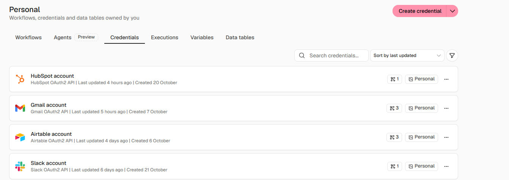

# Proyecto Final – Pipeline HITL con IA

## Ecosistema de Automatización IA

Proyecto final del curso de Automatización e Inteligencia Artificial.

El proyecto implementa un Pipeline HITL (Human-in-the-Loop) para la generación, revisión humana y envío automatizado de recordatorios personalizados.

## Tecnologías utilizadas

- **Orquestador:** Make
- **Base de datos y memoria:** Airtable
- **Procesamiento de Inteligencia Artificial:** IA mediante Claude
- **Canal de salida:** Gmail
- **Validación humana:** Human-in-the-Loop (HITL)

## Funcionamiento del sistema

El proceso se divide en dos escenarios principales:

### Escenario 1 – Generación y aprobación

1. Airtable contiene los recordatorios pendientes.
2. Make identifica los registros que deben procesarse.
3. La Inteligencia Artificial genera un mensaje personalizado.
4. El mensaje queda almacenado en Airtable.
5. El usuario realiza la aprobación humana antes del envío.

### Escenario 2 – Envío final

1. Make identifica únicamente los recordatorios aprobados.
2. Obtiene la información correspondiente desde Airtable.
3. Gmail realiza el envío del recordatorio.
4. Airtable actualiza el estado y registra la ejecución.

## Human-in-the-Loop

El sistema incorpora una etapa de validación humana antes de ejecutar la acción crítica de envío.

Esto permite evitar envíos automáticos sin supervisión y mantener el control sobre los mensajes generados por IA.

## Gestión de errores

El sistema contempla el registro de ejecuciones exitosas y errores.

Los errores se almacenan en Airtable dentro de la tabla **Registro de ejecuciones**, permitiendo mantener la trazabilidad y facilitar el monitoreo del sistema.

## Base de datos

**Link público de Airtable:**

https://airtable.com/appXAmDZ1F1e3ZpFt/shruiglNoHa59mPPN

La base contiene las tablas utilizadas para clientes, recordatorios y registro de ejecuciones.

## Documentación técnica

La documentación completa del proyecto se encuentra en:

- `DOCUMENTACIÓN TÉCNICA DEL ECOSISTEMA DE AUTOMATIZACIÓN IA (1).pdf`

Incluye la arquitectura, estructura de datos, esquemas JSON, matriz de costos, seguridad y resiliencia, pruebas, validación y Dashboard de Control.

## Blueprints de automatización

- `01 - Generación y aprobación de recordatorios IA.blueprint.json`
- `02 – Envío de recordatorios aprobados.blueprint.json`

Estos archivos contienen el respaldo técnico de los dos escenarios desarrollados en Make.

## Evidencias

La carpeta `evidencias` contiene las capturas de pantalla utilizadas como evidencia del funcionamiento del sistema:

- Flujo del escenario 1
- Flujo del escenario 2
- Generación de recordatorios mediante IA
- Aprobación humana HITL
- Registro de ejecuciones y gestión de errores
- Dashboard de Control

## Dashboard de Control

El Dashboard de Control fue desarrollado mediante Airtable Interfaces y permite visualizar indicadores relacionados con:

- Cantidad de ejecuciones
- Ejecuciones exitosas
- Ejecuciones con error
- Consumo aproximado de tokens
- Estado de los procesos
- Trazabilidad de las ejecuciones

## Autor

**Marcos Menghi**

**Año:** 2026

## Preentrega N.º 4 – Integraciones avanzadas en n8n

### Objetivo

Integrar herramientas externas de negocio al workflow existente, incorporando controles preventivos para evitar respuestas automáticas, duplicación de contactos y envío de correos sin revisión humana.

### Herramientas integradas

* **Orquestador:** n8n.
* **CRM:** HubSpot.
* **Casilla de correo:** Gmail.
* **Canal de operaciones:** Slack.

Las credenciales de las tres herramientas externas se conectaron mediante OAuth2.

### Controles implementados

1. **Filtro anti-auto-respuestas:** el nodo IF2 identifica determinados correos automáticos para evitar bucles.
2. **Búsqueda de contactos:** HubSpot Search contacts consulta si el contacto ya existe antes de decidir el siguiente paso.
3. **Validación de existencia:** IF3 dirige el flujo según el resultado de la búsqueda.
4. **Human-in-the-loop:** Gmail Create a draft genera un borrador para revisión humana, sin enviar automáticamente la respuesta.
5. **Limpieza de datos:** Edit Fields5 prepara un mensaje reducido con remitente, asunto y notificación.
6. **Notificación operativa:** Slack informa sobre la nueva consulta y la creación del borrador.

### Archivo del workflow

`checkpoint4_marcos_menghi.json`

El archivo JSON permite importar el workflow en n8n.

### Evidencias

Se incorporará una captura de la sección Credentials de n8n donde se visualicen las conexiones activas de HubSpot, Gmail y Slack.

### Evidencia de conexiones

Captura de las credenciales de HubSpot, Gmail y Slack configuradas en n8n.

